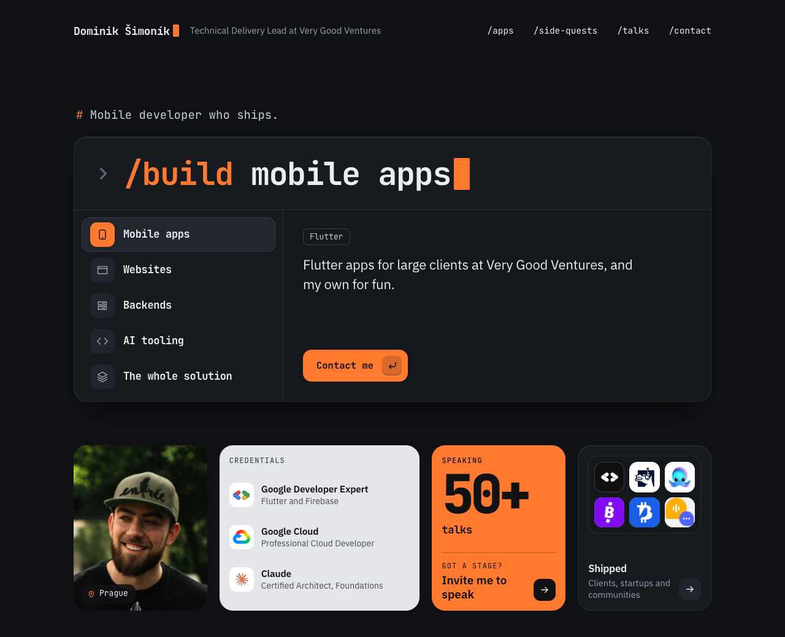

# ryzizub.com

The personal site of Dominik Šimoník, a mobile developer who ships. One static page that works like a command palette: type `/build`, pick what you need.

[](https://github.com/ryzizub/ryzizub-website/actions/workflows/verify.yml)
[](https://ryzizub.com)



## Stack

- **[Astro 7](https://astro.build)**, static output, one page and a 404
- **React 19 islands** for the two interactive parts (the `/build` palette, the apps launcher), styled with CSS Modules; everything else is Astro and ships no JavaScript
- **TypeScript** everywhere, strict
- **Content in JSON**, validated by Astro content collections
- **Share image** rendered at build time with [satori](https://github.com/vercel/satori) and resvg
- **nginx in Docker** in production

## Quick start

```bash
npm ci
npm run dev
```

Open http://localhost:4321. Node 24 (`.nvmrc`).

| Command            | What it does                                                   |
| :----------------- | :------------------------------------------------------------- |
| `npm run dev`      | Dev server                                                     |
| `npm run build`    | Production build to `dist/`                                    |
| `npm run preview`  | Serve `dist/` locally                                          |
| `npm run check`    | Types in `.astro`, `.ts` and `.tsx`                            |
| `npm run lint`     | Cognitive-complexity gate (ESLint + sonarjs)                   |
| `npm run literals` | Fails on a site fact typed outside `src/site.config.ts`        |
| `npm run a11y`     | axe (WCAG 2.2 AA) on `dist/` at desktop and phone width        |
| `npm run verify`   | All checks, then build and a11y. Run it before every PR        |

`npm run a11y` uses Playwright's Chromium (`npx playwright install chromium`) or, without it, the Chrome on your machine.

## Editing content

Copy lives in data, not in components. Every fact follows Dominik's Identity page (see `.claude/rules/content.md`).

| To change                                   | Edit                                                      |
| :------------------------------------------ | :-------------------------------------------------------- |
| Name, role, links, section titles, speaking | `src/site.config.ts`                                      |
| The `/build` palette rows                   | `src/content/builds.json`                                 |
| Credentials                                 | `src/content/credentials.json` + a mark in `src/assets/logos/` |
| Shipped apps                                | `src/content/apps.json` + an icon in `src/assets/apps/`   |
| Side quests                                 | `src/content/quests.json`                                 |
| Talks and articles                          | `src/content/talks.json` + a logo in `src/assets/logos/`  |
| The logo strip                              | `src/content/logos.json`                                  |
| The photo                                   | `src/assets/profile.jpeg`                                 |

Lists are shown in their `order`: apps newest first by start year, talks newest first.

## SEO and sharing

- Title, description, canonical URL and `robots` in `src/layouts/Base.astro`; the 404 page is `noindex`.
- Open Graph (`profile`) and X `summary_large_image` cards with `/og.png`, a 1200×630 card drawn from `src/lib/og-card.tsx` at build time.
- Structured data: `ProfilePage` with a `Person` (role, employer, skills, profiles) and `WebSite`.
- `/sitemap-index.xml`, `/robots.txt`, `/llms.txt` (the page as Markdown for language models) and `/apple-touch-icon.png`, all generated.

## Project structure

```text
src/
├── site.config.ts        facts the site states more than once
├── content.config.ts     schemas for src/content/*.json
├── content/              builds, credentials, apps, quests, talks, logos
├── assets/               logos/, apps/, profile.jpeg
├── styles/global.css     tokens, reset, shared pieces
├── layouts/Base.astro    <head>: SEO, sharing, structured data
├── components/           one per section; *.tsx islands with *.module.css
├── lib/                  icons, asset lookup, the share card
└── pages/                /, 404, og.png, apple-touch-icon.png, robots.txt, llms.txt
scripts/                  literals.ts, a11y.ts (run by Node directly)
```

Agents: `CLAUDE.md` and the path-scoped rules in `.claude/rules/`.

## CI

`.github/workflows/verify.yml` runs on every PR and push to `main`: the checks above, then the Docker image is built, started and probed (the page, the 404, the share image, `robots.txt`, caching and security headers). Dependabot groups weekly npm, Actions and base-image updates.

## Deploy

`Dockerfile` builds the site and serves `dist/` with nginx (`nginx.conf`: the 404 page, security headers, a year of caching for `/_astro/`).

```bash
docker compose up --build
```

The site is then on http://localhost:8480.

## License

[MIT](LICENSE)
